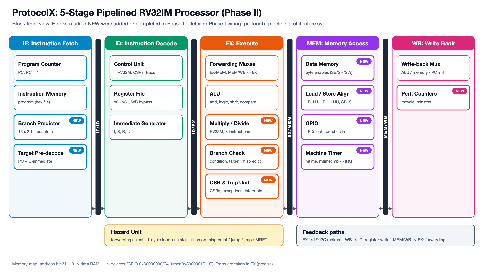
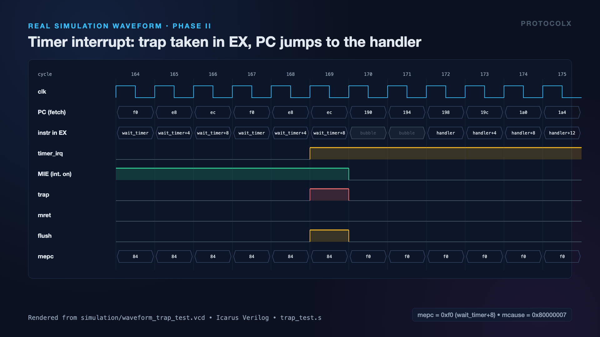
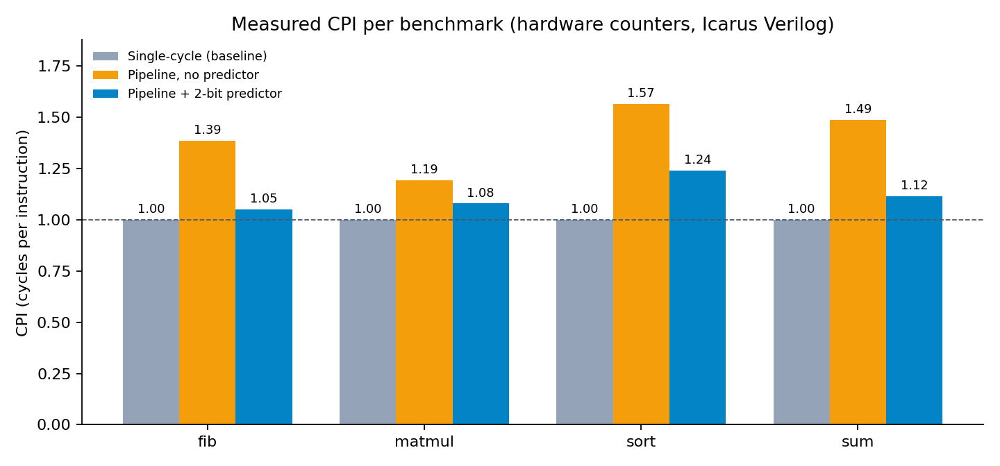

# PROTOCOLX: A 5-Stage Pipelined RV32IM Processor with Branch Prediction, Traps and Memory-Mapped I/O (Phase II Report)

**Team Members:**

- **Naveen Kumar** (Roll No: 2401020041) — Project Lead & Primary RTL Developer
- **Aditya Raj** (Roll No: 2401010032) — Technical Lead, Pipeline Design & Verification
- **Archit Mamodiya** (Roll No: 2401010095) — Literature Review & Research
- **Shagun Vishnoi** (Roll No: 2401020060) — IEEE Report & Documentation
- **Ritik Ranjan** (Roll No: 2401010388) — Architecture Diagrams, GitHub Documentation & Video Prep

**Department of Computer Science & Applications**

**Submission Date:** November 2026

---

## Abstract

In Phase I we built and verified a 5-stage pipelined RISC-V (RV32I) processor with data forwarding, a load-use stall and branch flushing. In Phase II we turned it into a more complete processor and measured how good it is. We added a **2-bit dynamic branch predictor**, the **RV32M multiply/divide extension**, **byte and half-word memory access**, **CSRs with precise exceptions and timer/external interrupts**, **memory-mapped GPIO and a machine timer**, and **hardware performance counters**. To compare fairly, we also built a **single-cycle baseline** from the same modules.

All features are verified in simulation (Icarus Verilog) by self-checking programs: a generated test of 234 cases covering every RV32IM instruction, a trap/interrupt test, and four benchmarks, plus the 51 Phase I checks. We used **mutation testing** (deliberately breaking the hardware) to show the tests can detect real bugs. The branch predictor lowers the pipeline's CPI from 1.19–1.57 to **1.05–1.24**. Using the open-source FPGA flow (Yosys + nextpnr) we measured real post-place-and-route clock frequencies: with the full RV32IM unit both cores are limited to about 5 MHz by the single-cycle divider (pipeline 5.45 MHz, single-cycle 4.94 MHz); without it the pipeline reaches **62.4 MHz versus 30.4 MHz**, making the benchmarks **1.65–1.95× faster** in real time than the single-cycle baseline.

**Index Terms** — RISC-V, pipelining, branch prediction, precise exceptions, FPGA, CPI.

---

## 1. Introduction

A pipeline only pays off if it keeps most of its stages busy. In Phase I every taken branch cost two cycles, and the core could only run integer arithmetic on whole words. Real programs need more:

- multiplication and division;
- reading and writing single bytes;
- reacting to the outside world (switches, timers);
- a way to recover from errors.

Phase II has two goals:

1. **Complete the processor**: the Phase II items planned in our Phase I report (CSRs, interrupts, branch prediction, RV32M, synthesis).
2. **Measure it honestly**: CPI and IPC from hardware counters, area and maximum frequency from synthesis and place-and-route, and a comparison against a single-cycle baseline, as the course project specification requires.

---

## 2. Phase II Architecture

*Fig. 1. Block-level view of the Phase II core. Blocks marked NEW were added or completed in Phase II. The detailed wire-level Phase I datapath is in `diagrams/protocolx_pipeline_architecture.svg`.*

### 2.1 Valid bit
Every pipeline register now carries a `valid` bit, which is 0 for bubbles (after reset, a stall or a flush). The performance counter counts only valid instructions, and interrupts are only attached to valid instructions, which have a meaningful PC.

### 2.2 Dynamic branch prediction
A 16-entry table of 2-bit saturating counters (`branch_predictor_2bit.v`, indexed by PC[5:2]) predicts whether a branch is taken. Because our instruction memory returns the instruction in the same cycle, the IF stage can already decode the B-type immediate and compute the target `PC + imm`. **No branch target buffer is needed.** The prediction travels with the instruction. EX compares it with the real outcome; on a mismatch the PC is redirected (to the target or to PC + 4), two instructions are flushed, and the counter is updated.

*Alternatives considered:* static not-taken (Phase I), 1-bit history (mispredicts twice per loop), resolving branches in ID (1-cycle penalty, but comparators and forwarding into ID lengthen that stage), and gshare (more accurate, more hardware).

### 2.3 RV32M
`muldiv_unit.v` implements MUL, MULH, MULHSU, MULHU, DIV, DIVU, REM and REMU in one combinational cycle. It handles the edge cases defined by the specification: division by zero returns −1 or the dividend, and overflow (−2³¹ ÷ −1) returns −2³¹ with remainder 0. Section 5 shows the cost of this simple choice: it limits the whole core to about 5 MHz.

### 2.4 Byte and half-word access
Loads use `mem_align_unit.v` (select and sign/zero-extend). Stores use `store_align_unit.v` (byte lanes and byte enables). The data memory has four byte-write enables. Its reset loop was removed so FPGA tools can implement it as RAM instead of flip-flops.

### 2.5 CSRs and traps
`csr_unit.v` implements Zicsr and the machine-mode CSRs: `mstatus`, `mie`, `mip`, `mtvec`, `mepc`, `mcause`, `mtval`, `mscratch`, `mcycle`, `minstret`. Exceptions (ECALL, EBREAK, illegal instruction) and interrupts (timer, external) are taken when the instruction is in **EX**:

- `mepc` ← PC of that instruction, and `mcause` ← the reason;
- interrupts are disabled (MIE ← 0);
- the two younger instructions are flushed, and the EX instruction is cancelled by a bubble in EX/MEM;
- the PC jumps to `mtvec`;
- MRET returns to `mepc` and restores MIE.

Older instructions in MEM and WB complete, so traps are **precise**.

### 2.6 Memory-mapped I/O and timer
Addresses with bit 31 set go to devices instead of RAM:

- GPIO output (LEDs) at `0x80000000`;
- GPIO input (switches) at `0x80000004`;
- the 64-bit `mtime` / `mtimecmp` timer at `0x80000010`–`1C`, which raises the timer interrupt.

### 2.7 Single-cycle baseline
`single_cycle_core.v` reuses the same control unit, ALU, multiply/divide unit, memories and devices without pipeline registers, so CPI = 1 by construction. Its register file disables the write-to-read bypass, which would form a combinational loop in a single-cycle design.

---

## 3. Verification

| Suite | What it checks | Result |
|---|---|---|
| Phase I testbenches (8) | ALU, register file, hazard unit, arithmetic, forwarding, load-use stall, branch flush, instruction subset with exact cycle count | 51/51 pass |
| Teammates' unit tests (4) | GPIO, load alignment, branch predictor, performance counter | pass |
| `isa_test` (generated) | **234 tests**: every RV32IM instruction with edge values, CSR operations, forwarding, load-use | pass, predictor on and off |
| `trap_test` | ECALL, EBREAK, illegal instruction, timer and external interrupts, GPIO, precise interrupt check | pass, predictor on and off |
| 4 benchmarks | self-checking results on 3 designs | pass |

**Generated tests.** `tools/gen_isa_test.py` computes every expected value with a small Python reference model, so no answer is calculated by hand. Programs are assembled by our own assembler (`tools/rvasm.py`), which was checked bit-for-bit against hand-encoded programs and reference encodings.

**Mutation testing.** We deliberately broke the hardware and confirmed each break was caught:

- inverted BNE;
- wrong sign on DIV;
- broken SB byte enables;
- wrong MULHSU signedness;
- removed the trap's EX/MEM flush.

This exposed and fixed two weaknesses: BNE had been untested in Phase I, and the test script printed "success" even when checks failed.

**Cycle-exact cross-check.** For `bench_sum` with prediction off: 654 instructions + 64 load-use stalls + 126 mispredictions × 2 + 4 fill cycles = **974 cycles**, exactly what the hardware counter measured.

*Fig. 2. Real simulation waveform (`simulation/waveform_trap_test.vcd`): the timer interrupt is taken on the instruction in EX (cycle 169), the younger instructions are flushed, `mepc` captures the interrupted PC, and fetch continues at the handler.*

---

## 4. Performance Results

| Benchmark | Single-cycle cycles (CPI) | Pipeline, no predictor cycles (CPI / IPC) | Pipeline + 2-bit predictor cycles (CPI / IPC) | Mispredictions (off → on) |
|---|---|---|---|---|
| fib (Fibonacci 30) | 160 (1.000) | 222 (1.387 / 0.721) | 168 (**1.050 / 0.952**) | 29 → 2 |
| sum (array of 64) | 654 (1.000) | 974 (1.489 / 0.672) | 730 (**1.116 / 0.896**) | 126 → 4 |
| sort (bubble sort, 32) | 3973 (1.000) | 6224 (1.566 / 0.639) | 4930 (**1.240 / 0.806**) | 860 → 213 |
| matmul (8×8, MUL) | 8638 (1.000) | 10302 (1.192 / 0.839) | 9330 (**1.080 / 0.926**) | 574 → 88 |

*Fig. 3. Measured CPI (from the hardware counters) for the three designs.*

**Findings:**

- The predictor removes **50–85 %** of the pipeline's extra cycles on loop-heavy code.
- `sort` keeps the most mispredictions, because whether two elements are swapped depends on the data.
- The remaining CPI above 1 comes from load-use stalls (64 in `sum`, 512 in `matmul`) and the 4-cycle pipeline fill.

---

## 5. Implementation Results (FPGA flow)

Vivado (for the Xilinx Artix-7 / Basys 3 named in our Phase I plan) does not run on macOS, and no board was available. We therefore used the open-source flow **Yosys → nextpnr → static timing** on a **Lattice ECP5 LFE5U-85F**. It produces real post-place-and-route timing without needing a board. The board-level top (`fpga/fpga_top.v`: clock, reset button, 16 switches → GPIO_IN, 16 LEDs ← GPIO_OUT) runs a demo program (`fpga/fpga_demo.s`) that uses every instruction type, so synthesis cannot delete unused hardware.

| Configuration | Fmax (MHz) | Critical path through | LUT4 | Flip-flops | DSP (18x18) |
|---|---|---|---|---|---|
| Pipeline (5-stage), RV32IM | **5.5** | muldiv, execution_unit | 14,964 | 2,022 | 4 |
| Single-cycle, RV32IM | **4.9** | muldiv, exec, dmem | 14,252 | 962 | 4 |
| Pipeline (5-stage), M removed* | **62.4** | dmem | 6,865 | 2,022 | 0 |
| Single-cycle, M removed* | **30.4** | dmem | 6,336 | 962 | 0 |

\* M removed = multiply/divide unit replaced by a stub (fpga/muldiv_stub.v) to measure the rest of each core.

Execution time, full RV32IM cores: time = cycles / Fmax

| Benchmark | Single-cycle | Pipeline + predictor | Speed-up |
|---|---|---|---|
| fib | 32.4 µs | 30.8 µs | **1.05×** |
| matmul | 1,748.6 µs | 1,711.9 µs | **1.02×** |
| sort | 804.3 µs | 904.6 µs | **0.89×** |
| sum | 132.4 µs | 133.9 µs | **0.99×** |

Execution time, cores without the M unit (benchmarks that use MUL excluded): time = cycles / Fmax

| Benchmark | Single-cycle | Pipeline + predictor | Speed-up |
|---|---|---|---|
| fib | 5.3 µs | 2.7 µs | **1.95×** |
| sort | 130.5 µs | 79.0 µs | **1.65×** |
| sum | 21.5 µs | 11.7 µs | **1.84×** |

**What the numbers show:**

1. **The divider sets the clock.** With RV32M, nextpnr's critical path lies entirely inside `muldiv_unit` for both cores, so pipelining cannot help: 5.45 vs 4.94 MHz. With CPI above 1, the pipeline is about as fast as the single-cycle core here (0.89–1.05×). The unit is also more than half of the logic: 14,964 LUT4s with it, 6,865 without.
2. **Pipelining doubles the clock once the divider is removed.** The pipeline runs at **62.4 MHz** and the single-cycle core at **30.4 MHz (2.05×)**. Even with a CPI of 1.05–1.24, the pipeline finishes the benchmarks **1.65–1.95× sooner**. This is the real benefit of pipelining: execution time = instructions × CPI × clock period.
3. **The measurement agrees with our earlier estimate.** Logic depth from synthesis predicted the pipeline's clock period to be about 40 / 21 ≈ 1.9× shorter; place-and-route measured 2.05×.
4. **The next critical path is the data-memory read** (LUT-RAM in MEM, then load alignment and write-back). It is the same in both cores.

**Consequence for Phase III:** replacing the combinational divider with a multi-cycle one (stalling the pipeline for about 32 cycles per divide) should let the full RV32IM pipeline approach the ~62 MHz of the M-less core. This is an expectation, not a measurement.

*Method:* `fpga/run_fmax.sh` (Yosys `synth_ecp5`, nextpnr-ecp5 `--85k --package CABGA381`, seed 1, timing-driven placement), summarised by `fpga/summarize.py`. Benchmark cycle counts come from the simulations in Section 4 (`matmul` is excluded for the M-removed cores because it uses MUL). These are ECP5 numbers; a Xilinx Artix-7 result would differ in absolute MHz.

---

## 6. Problems Encountered and Solutions

| Problem | Cause | Solution |
|---|---|---|
| Design simulated correctly but did not synthesize | Reset and flush tested together (`!rst_n` OR `flush`) inside an asynchronous-reset block (`pipe_id_ex`, and again later in `pipe_ex_mem`) | Separate the reset branch from the synchronous flush branch |
| Test script reported success with failing checks | `vvp` exits 0 even when checks fail | The script searches the log for failures and exits 1 |
| Synthesis reported only 103 cells for a CPU | An empty instruction ROM made every instruction constant, so the tools deleted the datapath | Black-box the instruction memory for area runs; use a real demo program for FPGA runs |
| FPGA run optimised away the whole CPU | The simulation-only NOP-fill loop in `instruction_memory.v` became memory *write* ports in synthesis, so the program was lost | NOP fill is now inside `` `ifndef SYNTHESIS `` |
| Trap test timed out | The handler used `t5`/`t6`, which **are** `x30`/`x31` (our result-address and test-number registers) | The handler uses `a6`/`a7` |
| Instruction count off by one | The testbench sampled signals exactly at the clock edge, before flip-flops update | Sample 1 ns after the edge; three independent counts now agree |
| Timer compare on the longest path | 64-bit `mtime ≥ mtimecmp` fed the trap and redirect logic in the same cycle | Register `timer_irq` (1-cycle delay, invisible to software) |

---

## 7. Scope and Future Work

**Completed in Phase II:** every item planned in the Phase I report except the board demonstration, plus measured CPI/IPC, a single-cycle baseline, and post-place-and-route Fmax.

**Not done / future work:**

- **Board demonstration.** No board or Vivado was available. The demonstration is the simulation, with waveforms and benchmark results. `fpga/fpga_top.v` is ready for a board.
- **A multi-cycle divider.** The combinational divider dominates area and limits the clock to ~5 MHz (Section 5).
- **Misaligned-access exceptions, JAL prediction, caches**, and the official `riscv-arch-test` compliance suite.

---

## 8. Individual Team Contributions (Phase II)

Taken from the project's git history:

| Member | Phase II contribution |
|---|---|
| Naveen Kumar | Integration of all Phase II features into the core; RV32M unit; CSR/trap unit; timer; store alignment; single-cycle baseline; assembler and generated tests; benchmarks; synthesis and FPGA flow; documentation |
| Aditya Raj | 2-bit branch predictor (`branch_predictor_2bit.v`) and its unit test |
| Archit Mamodiya | Hardware performance counter (`perf_counter.v`) and its unit test |
| Shagun Vishnoi | Byte/half-word load alignment unit (`mem_align_unit.v`) and its unit test |
| Ritik Ranjan | Memory-mapped GPIO unit (`gpio_unit.v`) and its unit test |

---

## 9. References

[1] A. Waterman and K. Asanović, "The RISC-V Instruction Set Manual, Volume I: Unprivileged ISA," Version 20191213, RISC-V Foundation, Dec. 2019.

[2] A. Waterman, K. Asanović and J. Hauser, "The RISC-V Instruction Set Manual, Volume II: Privileged Architecture," Version 20211203, RISC-V International, 2021.

[3] D. A. Patterson and J. L. Hennessy, *Computer Organization and Design: The Hardware/Software Interface (RISC-V Edition)*, Morgan Kaufmann, 2017.

[4] J. L. Hennessy and D. A. Patterson, *Computer Architecture: A Quantitative Approach*, 6th ed., Morgan Kaufmann, 2019.

[5] J. E. Smith, "A Study of Branch Prediction Strategies," in *Proc. 8th Annu. Int. Symp. Computer Architecture (ISCA)*, 1981, pp. 135–148.

[6] C. Wolf, "Yosys Open SYnthesis Suite." [Online]. Available: https://yosyshq.net/yosys/

[7] YosysHQ, "nextpnr — a portable FPGA place and route tool." [Online]. Available: https://github.com/YosysHQ/nextpnr
