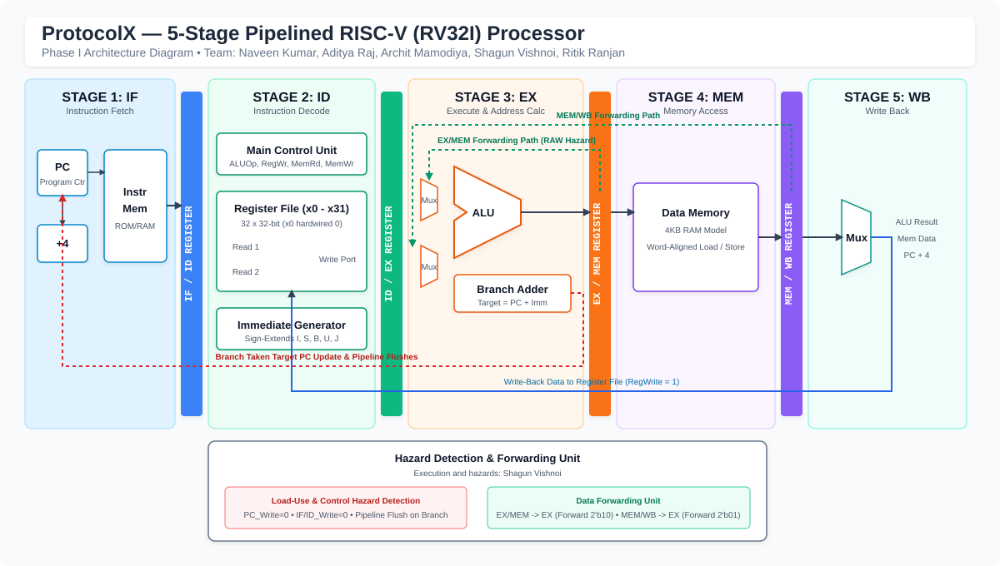

# PROTOCOLX: Performance Evaluation and FPGA Implementation of a 5-Stage Pipelined RV32I Processor (Phase II Report)

**Team Members:**

- **Naveen Kumar** (Roll No: 2401020041) — Core architecture
- **Aditya Raj** (Roll No: 2401010032) — Pipeline registers and verification
- **Archit Mamodiya** (Roll No: 2401010095) — Instruction decode and memory
- **Shagun Vishnoi** (Roll No: 2401020060) — Execution and hazards
- **Ritik Ranjan** (Roll No: 2401010388) — Reports, presentation and documentation

**Department of Computer Science & Applications**

**Submission Date:** November 2026

---

## Abstract

In Phase I we designed and verified a 5-stage pipelined RISC-V (RV32I) processor in Verilog, with data forwarding, a load-use stall and branch flushing. Phase II answers the question a pipeline must answer: *is it actually faster?* We built a **single-cycle baseline** from the same modules, wrote four benchmark programs (with our own assembler), measured **CPI and IPC** for both designs, and measured the **real maximum clock frequency** of both with an open-source FPGA flow (Yosys and nextpnr on a Lattice ECP5).

The pipeline needs more cycles per instruction (CPI 1.35–1.57, against exactly 1.00 for the baseline) but its clock is **1.75× faster** (67.8 MHz against 38.8 MHz), so the benchmarks finish **1.12× to 1.30× sooner**. The extra cycles are fully explained by a simple model, `cycles = N + 4 + stalls + 2 × flushes`, which matched the measurement exactly on all four benchmarks. Verification uses self-checking programs (a generated 146-test RV32I program and the four benchmarks, on both designs) plus the 51 Phase I checks, and we used **mutation testing** to show the tests can detect real bugs.

**Index Terms** — RISC-V, pipelining, CPI, IPC, FPGA, place and route, single-cycle baseline.

---

## 1. Introduction

A pipeline overlaps the execution of several instructions, which shortens the clock period, but hazards force it to stall or flush, which raises the number of cycles per instruction (CPI). Whether the trade is worthwhile can only be decided by measuring both effects together:

> execution time = instructions × CPI × clock period

Phase II therefore has three goals, following the course project specification for the pipelined RISC-V processor:

1. **A baseline:** verify a single-cycle datapath first and use it for comparison.
2. **Performance:** measure CPI and IPC on benchmark programs.
3. **Implementation:** report resource use and the maximum operating frequency.

**Scope.** In the Phase I report we listed possible extensions (exception handling with CSRs, interrupts, dynamic branch prediction, an RV32M multiplier and divider). They are not part of the project specification, so the final design deliberately stays a plain RV32I processor: the instruction subset required by the specification plus the rest of the RV32I base set, with word-sized loads and stores.

---

## 2. Design

*Fig. 1. The 5-stage pipeline (wire-level diagram by Ritik Ranjan).*

### 2.1 Pipelined core
Five stages (IF, ID, EX, MEM, WB) separated by four pipeline registers. A hazard unit provides:

- **Forwarding** from EX/MEM and MEM/WB into the ALU inputs (EX/MEM has priority, as it holds the newer value);
- a **1-cycle stall** for a load followed immediately by its use;
- a **flush** of the two younger instructions when a branch or jump is taken (resolved in EX).

The branch policy is "always not taken": a taken branch costs two cycles, a branch that is not taken costs nothing.

### 2.2 Single-cycle baseline
`rtl/single_cycle_core.v` reuses the same control unit, execution unit, register file, immediate generator and memories, without pipeline registers, forwarding or hazards. Every instruction takes exactly one cycle, so CPI = 1 by construction. Its register file disables the write-to-read bypass, which would otherwise create a combinational loop in a single-cycle design.

### 2.3 Cycle model
For a program of N instructions on the pipeline:

> cycles = N + 4 + S + 2·T

where 4 is the pipeline fill, S the number of load-use stall cycles and T the number of taken branches and jumps. This model is checked against the measurement for every benchmark (Section 4).

---

## 3. Verification

| Suite | What it checks | Result |
|---|---|---|
| Phase I testbenches (8) | ALU, register file, hazard unit, arithmetic, forwarding, load-use stall, branch flush, 7-instruction subset with exact cycle count | 51 / 51 pass |
| `isa_test` (generated) | **146 tests**: every RV32I instruction with edge values, forwarding chains, load-use, all six branch types with signed and unsigned operands, JAL and JALR, writes to x0 | pass on pipeline **and** single-cycle |
| 4 benchmarks | each program checks its own answer | pass on both designs |

**Self-checking programs.** A program stores `1` (pass) or a failure code to the last word of data RAM; the testbench reads it. Nobody has to read waveforms to know whether a test passed.

**Generated tests with a golden model.** `scripts/gen_isa_test.py` computes every expected value with a small Python reference model, so no answer is calculated by hand. Programs are assembled by our own assembler (`scripts/rvasm.py`), which we checked bit for bit against hand-encoded programs and reference encodings.

**Mutation testing.** We deliberately broke the hardware and confirmed each break was detected, and that the failure message named the broken instruction:

| Injected bug | Detected by |
|---|---|
| BNE condition inverted | subset test: "BNE loop sum expected 15, got 5" |
| SRA behaves like SRL | ALU unit test: "SRA −2³¹ >>> 2" |
| Forwarding from EX/MEM disabled | hazard-unit test and the pipeline forwarding tests |

**Cycle-exact cross-check.** For `sum`: 654 instructions + 4 + 64 stalls + 2 × 126 flushes = **974 cycles**, exactly the measured value (Section 4). Because the count is exact, a change to the hazard logic that adds or removes even one cycle makes the test fail.

---

## 4. Performance Results

CPI and IPC come from simulation. N is the instruction count measured on the single-cycle core; cycles, stalls and flushes are counted on the pipeline by `testbench/tb_programs.v`.

| Benchmark | N | Pipeline cycles | CPI | IPC | Stalls S | Flushes T | N + 4 + S + 2T |
|---|---|---|---|---|---|---|---|
| fib (Fibonacci 30) | 160 | 222 | 1.387 | 0.721 | 0 | 29 | 222 ✔ |
| sum (array of 64) | 654 | 974 | 1.489 | 0.671 | 64 | 126 | 974 ✔ |
| sort (bubble sort, 32 values) | 3,973 | 6,224 | 1.567 | 0.638 | 527 | 860 | 6,224 ✔ |
| matmul (8×8, shift-and-add multiply) | 21,742 | 29,326 | 1.349 | 0.741 | 0 | 3,790 | 29,326 ✔ |

The single-cycle baseline has CPI 1.000 and IPC 1.000 on every program.

*Fig. 2. Where the pipeline's cycles go. The bottom segment (1.00) is useful work; the rest is pipeline fill, load-use stalls and branch flushes.*

**Findings.**

- **Flushes dominate.** Taken branches and jumps account for most of the extra cycles, because every taken branch wastes two fetches. Loops are made of taken branches, so loop-heavy code (`fib`, `sum`, `sort`) pays the most.
- **Load-use stalls matter for memory-heavy code.** `sort` (527 stalls) and `sum` (64) show them; `fib` and `matmul` have none.
- **The 4-cycle fill is negligible on long programs** (4 of 21,742 for `matmul`) but visible on short ones.

---

## 5. Implementation Results

Vivado, needed for the Xilinx Artix-7 / Basys 3 named in our Phase I plan, does not run on macOS, and no board was available. We therefore used the open-source flow **Yosys → nextpnr → static timing** on a **Lattice ECP5 LFE5U-85F**, which gives real post-place-and-route timing without a board. Both designs are built with the same board-level top (`fpga/fpga_top.v`: clock, reset button, 16 LEDs driven by the written-back value) and run the same demo program (`fpga/fpga_demo.s`), which uses every instruction, so synthesis cannot remove unused hardware.

| Design | Fmax (MHz) | LUT4 | Flip-flops | Critical path |
|---|---|---|---|---|
| **5-stage pipeline** | **67.8** | 5,100 | 1,541 | data-memory read (MEM stage) |
| Single-cycle baseline | 38.8 | 5,161 | 722 | data-memory read after the ALU |

Both designs use about 6 % of the chip's logic. Execution time = cycles / Fmax:

| Benchmark | Single-cycle | Pipeline | Speed-up |
|---|---|---|---|
| fib | 4.1 µs | 3.3 µs | **1.26×** |
| sum | 16.9 µs | 14.4 µs | **1.17×** |
| sort | 102.4 µs | 91.9 µs | **1.12×** |
| matmul | 560.5 µs | 432.8 µs | **1.30×** |

**Discussion.**

1. **Pipelining shortens the clock by 1.75×** (67.8 against 38.8 MHz) and costs 1.35–1.57× more cycles, so the net gain is 1.12–1.30×. It is a real but modest gain, because our simple "always not taken" policy loses two cycles on every taken branch.
2. **The pipeline uses about twice the flip-flops** (1,541 against 722) for its four pipeline registers, with almost the same amount of logic.
3. **The critical path is the data-memory read** in both designs. Splitting that read, or registering the memory address earlier, would be the next timing optimisation. Reducing the branch penalty (for example with branch prediction) would improve the CPI side.
4. **Area estimate with a second tool.** Yosys with Xilinx 7-series mapping (`make synth`) gives about 2,056 LUTs and 1,525 flip-flops for the pipelined core (instruction memory excluded).

*Method:* `scripts/run_fmax.sh` (Yosys `synth_ecp5`, nextpnr-ecp5 `--85k --package CABGA381`, seed 1) and `scripts/summarize_fmax.py`. These are ECP5 results; absolute MHz would differ on an Artix-7, but the comparison between the two designs is what matters.

---

## 6. Problems Encountered and Solutions

| Problem | Cause | Solution |
|---|---|---|
| Design simulated correctly but did not synthesize | `!rst_n OR flush` tested together inside an asynchronous-reset block (`pipe_id_ex`) | Separate the reset branch from the synchronous flush branch |
| BNE was never tested | No Phase I test ran a BNE instruction; found when an inverted BNE still passed | Subset test with a BNE loop, then the 146-test ISA program |
| Test script printed "success" even when checks failed | `vvp` exits with 0 even when checks fail | The script now searches the log for failures and exits with 1 |
| Synthesis reported only 103 cells for a CPU | The empty instruction ROM made every instruction constant, so the tools deleted the datapath | Black-box the ROM for area runs; use a real demo program for FPGA runs |
| FPGA run removed the whole CPU again | The simulation-only NOP-fill loop in `instruction_memory.v` became memory *write* ports in synthesis, so the program was lost | The fill loop is now inside `` `ifndef SYNTHESIS `` |
| False combinational-loop warning on the single-cycle core | The register-file bypass multiplexer was always built | The bypass is a `generate` option, off for the single-cycle core |
| RAM built from flip-flops | A reset loop cleared all 1,024 data words in one cycle | Removed the loop; the RAM starts as zeros in simulation and maps to RAM resources |
| Instruction count off by one | The testbench sampled signals exactly at the clock edge, before flip-flops update | Sample 1 ns after the edge; three independent counts now agree |

---

## 7. Scope and Future Work

**Completed in Phase II:** single-cycle baseline, benchmarks with CPI/IPC, own assembler and generated test program, mutation testing, synthesis and real Fmax, this report.

**Not done / future work:**

- **Board demonstration.** No board or Vivado was available; the demonstration is the simulation with waveforms and benchmark results. `fpga/fpga_top.v` is ready for a board.
- **Branch prediction** (a separate project in the course) would cut the 2-cycle cost of a taken branch.
- **A faster memory path** and caches, since the data-memory read limits the clock.

---

## 8. Team Responsibilities

Final responsibility allocation. Each member answers for these parts of the project (review, explanation, questions). The stage-by-stage view and the historical Phase I record are in `docs/CONTRIBUTIONS.md`.

| Member | Area | Responsible for |
|---|---|---|
| Naveen Kumar | Core architecture | `riscv_core.v`, `riscv_defines.vh`, `pipe_if_id.v`, `instruction_memory.v` |
| Aditya Raj | Pipeline registers and verification | `pipe_id_ex.v`, `pipe_ex_mem.v`, `pipe_mem_wb.v`, `tb_hazard_unit.v`, `tb_alu.v`, the verification report and test evidence |
| Archit Mamodiya | Instruction decode and memory | `control_unit.v`, `reg_file.v`, `imm_gen.v`, `data_memory.v`, `tb_riscv_mem.v` |
| Shagun Vishnoi | Execution and hazards | `alu.v`, `execution_unit.v`, `hazard_unit.v`, `tb_riscv_hazard.v`, `tb_riscv_branch.v` |
| Ritik Ranjan | Reports, presentation and documentation | IEEE Phase I and Phase II reports, the presentation, architecture diagrams, `README.md`, demonstration video material |

Teammates also wrote optional extension modules during Phase II (a 2-bit branch predictor, a performance counter, a load-alignment unit and a GPIO unit). They are not part of the final design, which follows the project specification, but they remain in the repository's git history.

---

## 9. References

[1] A. Waterman and K. Asanović, "The RISC-V Instruction Set Manual, Volume I: Unprivileged ISA," Version 20191213, RISC-V Foundation, Dec. 2019.

[2] D. A. Patterson and J. L. Hennessy, *Computer Organization and Design: The Hardware/Software Interface (RISC-V Edition)*, Morgan Kaufmann, 2017.

[3] J. L. Hennessy and D. A. Patterson, *Computer Architecture: A Quantitative Approach*, 6th ed., Morgan Kaufmann, 2019.

[4] C. Wolf, "Yosys Open SYnthesis Suite." [Online]. Available: https://yosyshq.net/yosys/

[5] YosysHQ, "nextpnr — a portable FPGA place and route tool." [Online]. Available: https://github.com/YosysHQ/nextpnr
